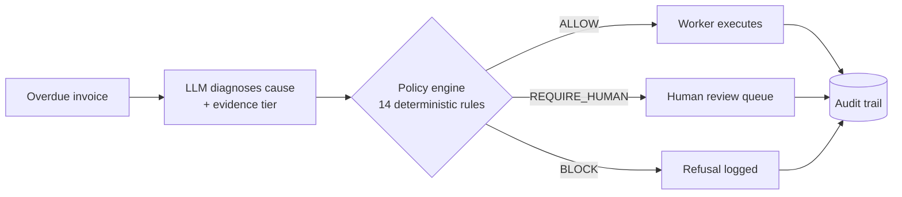

<p align="center">
  
</p>

<p align="center">
  I build AI agents for Indian businesses, in collections, invoicing, banking and healthcare,<br/>
  where one wrong action costs real money.
</p>

<table align="center">
  <tr>
    <td align="center"><h2>0</h2><sub>inappropriate agent actions<br/>across 2 held-out runs</sub></td>
    <td align="center"><h2>869</h2><sub>tests behind<br/>one agent</sub></td>
    <td align="center"><h2>5</h2><sub>Indian languages in a<br/>live voice platform</sub></td>
    <td align="center"><h2>Top 50</h2><sub>of 500 at the<br/>Lyzr Agentathon 2026</sub></td>
  </tr>
</table>

---

## What a refusal looks like

A client disputes an invoice. A normal bot sends another reminder. My agent refuses, and writes down why:

```json
{
  "decision": "REQUIRE_HUMAN",
  "reasons": ["dispute_signal_detected_in_client_notes"],
  "allowed_actions": ["escalate_to_human", "create_dispute_record"],
  "blocked_actions": ["send_reminder", "send_collection_message", "create_payment_link"],
  "evaluated_at": "2026-08-22T04:30:00Z"
}
```

That is a real decision from [RecoverRight](https://github.com/pranavv05/recoverright)'s audit trail. No model output can loosen it.



## How I build

**The LLM proposes, code decides.** Every action passes a deterministic policy engine. A model can tighten a decision. It can never loosen one.

**Fail closed.** If the model is down or returns garbage, the invoice goes to a human. It does not silently vanish.

**Measure, then admit it.** Safety and accuracy are reported side by side, including where the system is wrong.

## Where my agents still fail

RecoverRight's own README says it plainly:

- Cause-diagnosis accuracy is about **45%**. The model is the bottleneck, not the policy engine.
- **5 of 14** safe invoices were over-escalated to a human. That is the price of failing closed.
- An early version of the content rules was fitted to held-out text. I disclosed it and rewrote the rules.

Safety numbers stayed identical across both runs while the model was wrong more than half the time. That is the point of the design.

---

## Shipped

| | What it is | Proof |
|---|---|---|
| **[RecoverRight](https://github.com/pranavv05/recoverright)** | Receivables-recovery agent that acts only when policy allows. Built solo at the Razorpay AI Buildathon 2026. | 0 inappropriate actions, 100% hard-stop block rate on held-out data. [Demo video](https://www.youtube.com/watch?v=s-3B0S9CR_w) |
| **[Verax TallyOCR](https://github.com/pranavv05/verax)** | B2B SaaS for Indian CA firms: invoices and bank statements to TallyPrime-ready entries in about 30 seconds. | Piloting with 2 CA firms. Postgres row-level-security tenant isolation, CI, Docker. [Live](https://ca-saas-platform.vercel.app) |
| **[QueryFix](https://github.com/pranavv05/QueryFix)** | Open-source PR bot that flags slow and unsafe SQL/JPA queries, including cross-file N+1. | Same diff, same findings. About 1,000 tests. Static-analysis stage only so far. |
| **[BabyCollab](https://github.com/pranavv05/babycollab)** | Student platform I founded to find teammates and build a portfolio. | 70+ signups in week one. |
| **[Agentic SDD Platform](https://github.com/pranavv05/agenticsdlc)** | Agents turn a requirement into approved specs with human sign-off, then hand off to Claude Code over MCP. | My concept, built with 3 teammates. In progress. |

## Where I've worked

- **Finzly (BankOS), Aug to Oct 2026.** Built QueryGuard, an AI PR reviewer the team adopted over its existing tool: 50+ PRs reviewed, 30 to 40% cheaper. Also ran a 9-week AI course for the engineering team.
- **Pinhead Analytics, two terms.** Shipped healthcare voice agents that take live patient calls, expanded from English-only to 5 Indian languages. Rehired for a second term.
- **Enjay IT Solutions, 2024.** React and MERN modules, 28% faster page loads.

---

**Stack:** Python, TypeScript, FastAPI, Node.js, PostgreSQL, Redis, Qdrant, LangGraph, MCP, LiveKit, Sarvam AI, Docker.

B.Tech CSE at M S Ramaiah University of Applied Sciences, Bengaluru. I speak English, Hindi and Marathi, which is why I care about vernacular-first AI.

**Open to AI engineering work and freelance projects.**

[](https://linkedin.com/in/pranavvatsa)
[](https://x.com/vatsapranav_)
[](https://pranavv05.vercel.app)
[](https://medium.com/@pranavmmishra2005)
