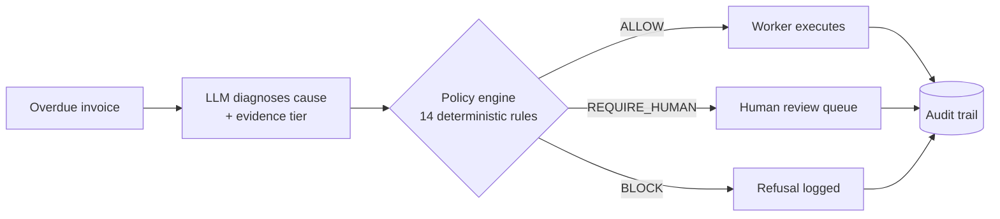

  

I build AI agents for Indian businesses, in places like collections, invoicing and compliance, where one wrong action costs real money.

My rule: **the LLM proposes, deterministic code decides.** Every agent I ship has a policy layer the model cannot talk its way past, and an audit trail for every refusal.

---

## The pattern behind my work

This is the architecture of **RecoverRight**. The model can be wrong and the system still holds: across two held-out runs, safety metrics did not move while diagnosis accuracy sat around 45%.

---

## Proof of work

| Project | What it is | Evidence |
|---|---|---|
| **[RecoverRight](https://github.com/pranavv05/recoverright)** | Autonomous B2B receivables-recovery agent. Diagnoses why an invoice is unpaid, acts only if policy allows. | 0 inappropriate actions and 100% hard-stop block rate on held-out data, both runs. 869 tests. [Demo video](https://www.youtube.com/watch?v=s-3B0S9CR_w) |
| **[Verax TallyOCR](https://github.com/pranavv05/verax)** | Multi-tenant SaaS for Indian CA firms: OCR, LLM extraction, CA review, TallyPrime XML export. | Postgres row-level-security tenant isolation, queued processing with retries, CI, Docker and Render deploys. [Live](https://ca-saas-platform.vercel.app) |
| **[QueryFix](https://github.com/pranavv05/QueryFix)** | GitHub PR bot that flags slow and unsafe SQL/JPA queries, including cross-file N+1 patterns. | Deterministic rules (same diff, same findings), about 1,000 tests, strict typing. Pilot stage. |
| **[BabyCollab](https://github.com/pranavv05/babycollab)** | Student collaboration platform I founded: find teammates, run projects, build a portfolio. | Next.js, Prisma, Clerk, deployed. <!-- TODO: add real user / project counts --> |
| **[Agentic SDD Platform](https://github.com/pranavv05/agenticsdlc)** | Agents that turn a requirement into approved specs with human gates, then hand off to Claude Code over MCP. Team of 4. | <!-- TODO: state exactly which part you built --> |

---

## I publish what my systems get wrong

Most portfolios only show wins. RecoverRight's README also states:

- Cause-diagnosis accuracy is about **45%**. The model is the bottleneck, not the policy engine.
- **5 of 14** safe invoices were over-escalated to a human. That is the price of failing closed.
- An early version of the content rules was fitted to held-out text. I disclosed it and rewrote the rules.

If I'm going to run agents on your money, you should see how they fail before you trust them.

---

## Stack

Python, FastAPI, Node.js, PostgreSQL (RLS), Redis and BullMQ, React, Next.js, Docker, LLM APIs (Groq, NVIDIA NIM), MCP.

## Experience

- **Gen AI Engineer Intern, Pinhead Analytics.** Production multi-agent voice platform serving Gujarati, Marathi, Kannada and Bengali.
- **Web Developer Intern, Enjay IT Solutions.**

I speak English, Hindi and Marathi, which is why I care about vernacular-first AI.

---

**Open to AI engineering work and freelance projects.**

